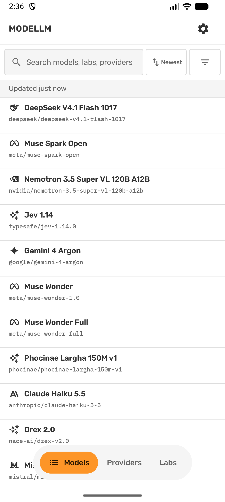
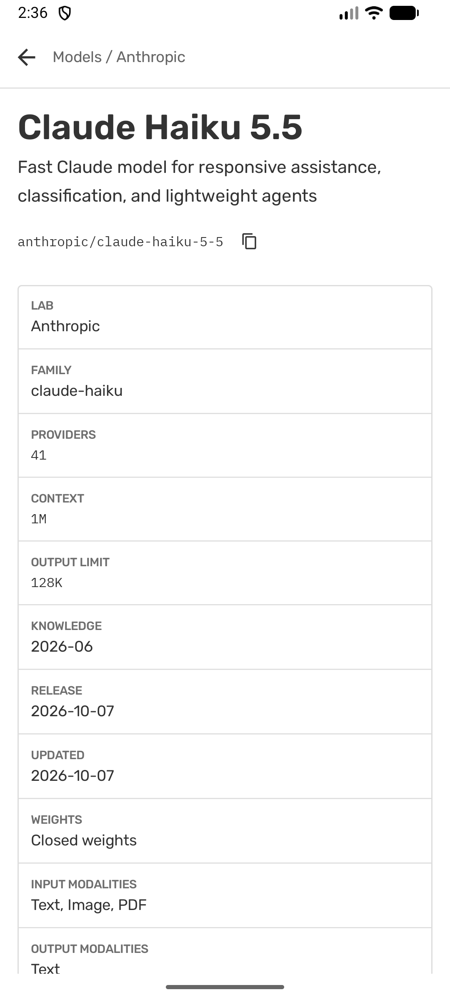
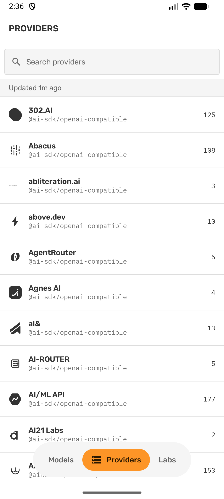
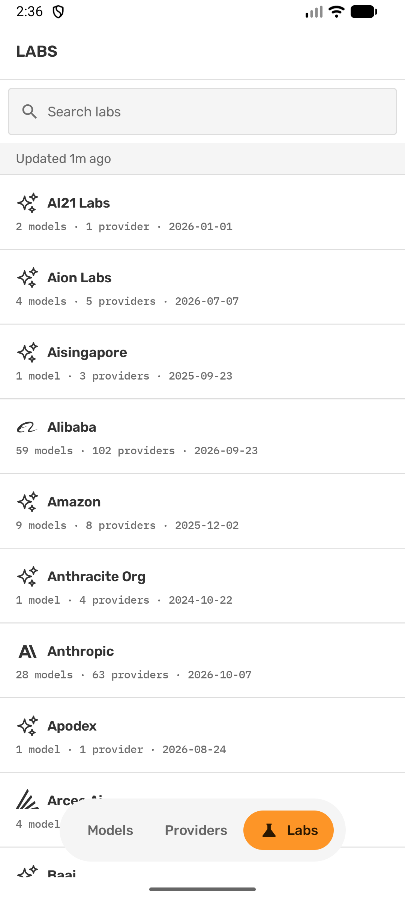

# ModeLLM

[](LICENSE)
[](#requirements)
[](https://kotlinlang.org)
[](https://developer.android.com/compose)

An offline-first Android client for [models.dev](https://models.dev)

## Screenshots

<table>
  <tr>
    <td align="center"><br />Models</td>
    <td align="center"><br />Model detail</td>
  </tr>
  <tr>
    <td align="center"><br />Providers</td>
    <td align="center"><br />Labs</td>
  </tr>
</table>


## Tech stack

| Area | Technology |
|---|---|
| UI | Jetpack Compose, Material 3 |
| Architecture | MVVM, unidirectional data flow, single activity |
| Persistence | Room with FTS4 full-text search |
| Networking | Ktor Client with OkHttp, kotlinx.serialization |
| Dependency injection | Koin |
| Async | Coroutines and Flow |
| Images | Coil 3 with SVG support |
| Background work | WorkManager |
| Settings | DataStore Preferences |
| Navigation | Navigation Compose with type-safe routes |

## Requirements

- Android Studio with support for Android Gradle Plugin 9.4
- JDK 17 or later
- Android SDK 37
- A device or emulator running Android 7.0 (API 24) or later

## Build and run

Clone the repository and build the debug APK:

```bash
git clone https://github.com/ronellsalunke/ModeLLM.git
cd ModeLLM
./gradlew assembleDebug
```

## Release builds

Create `keystore.properties` in the repository root. Git ignores this file.

```properties
storeFile=path/to/your-keystore.jks
storePassword=your-store-password
keyAlias=your-key-alias
keyPassword=your-key-password
```

Build the release APK:

```bash
./gradlew assembleRelease
```

Without `keystore.properties`, the build skips the release signing configuration and produces an unsigned APK.

## Project structure

```text
app/src/main/java/dev/ronellsalunke/modellm/
├── data/
│   ├── local/        Room database, entities, DAOs, and FTS tables
│   ├── remote/       Ktor client, DTOs, and catalog payload
│   ├── mapper/       DTO to entity to domain mapping
│   ├── repository/   Catalog repository and sync state
│   ├── settings/     DataStore preferences
│   └── sync/         WorkManager worker and scheduler
├── di/               Koin modules
└── ui/
    ├── components/   Shared Compose components
    ├── labs/         Lab list and detail
    ├── models/       Model list, filters, and detail
    ├── navigation/   Type-safe routes
    ├── providers/    Provider list and detail
    ├── settings/     Settings and about
    └── theme/        Colors, type, shapes, and dimensions
```

## Contributing

1. Fork the repository.
2. Create a branch for your change.
3. Make your change and keep it focused.
4. Run `./gradlew test` and build the app.
5. Open a pull request.

Match the existing Compose and data-layer patterns.
Report bugs and request features in [GitHub Issues](https://github.com/ronellsalunke/ModeLLM/issues).

## Credits

- Catalog data and logos: [models.dev](https://models.dev)
- Fonts: Rubik and IBM Plex Mono, licensed under the SIL Open Font License
- Built with [Android Jetpack](https://developer.android.com/jetpack)

## License

ModeLLM is released under the [MIT License](LICENSE).

Copyright (c) 2026 Ronell Salunke
